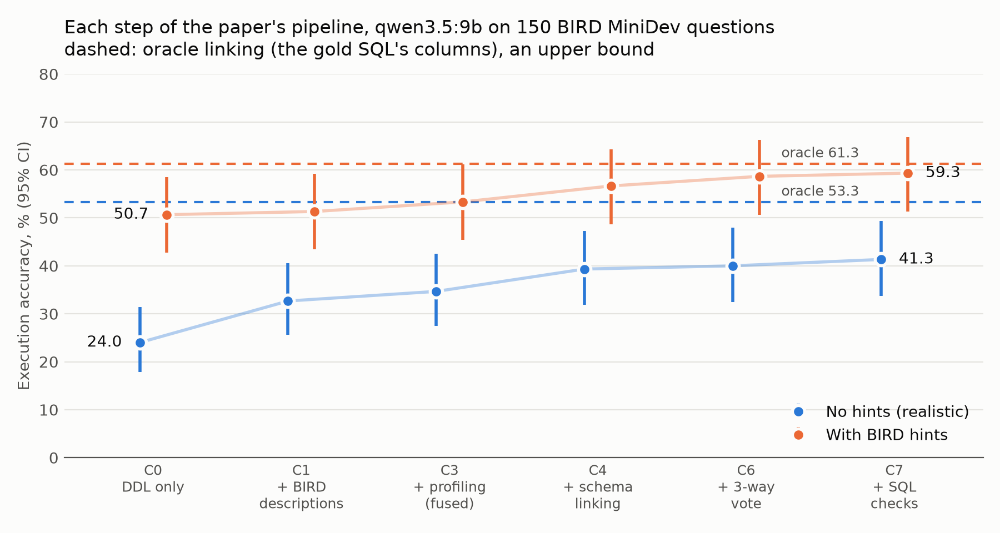
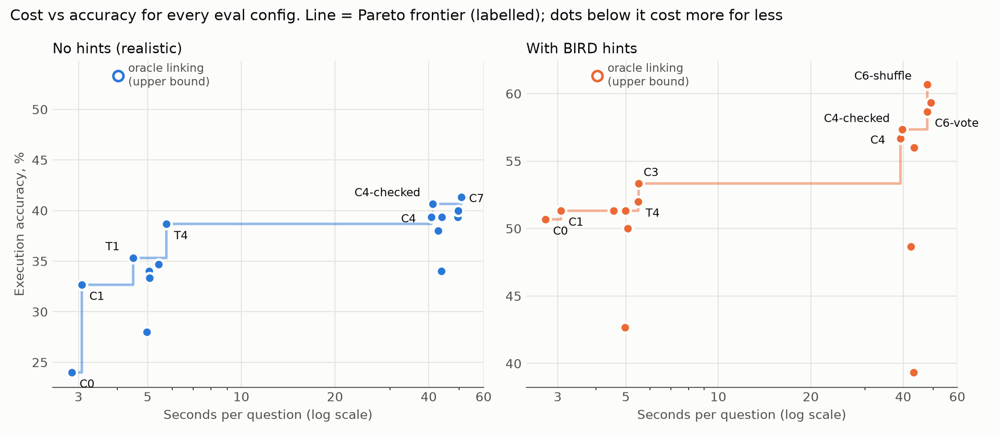

# Automatic metadata for text-to-SQL, ablated on a local 9B model

AT&T's paper [*Automatic Metadata Extraction for Text-to-SQL*](https://arxiv.org/abs/2505.19988) (Shkapenyuk, Srivastava, Johnson, Ghane, 2025) reached #1 on the BIRD leaderboard with GPT-4o. Its pipeline:
- describes every column automatically, from database profiling;
- narrows the schema with a schema-linking step that writes SQL to find the relevant columns;
- adds few-shot examples, several candidate queries, SQL sanity checks and a vote.

The paper reports the profiling and linking steps together. It doesn't isolate the few-shot examples, the voting or the checks.

This project rebuilds that pipeline and runs it on **`qwen3.5:9b` locally (MacBook Pro M3 Pro, 18 GB)**. It uses [promptfoo](https://www.promptfoo.dev/) to measure, one change at a time:
- what each step adds;
- what it costs in tokens and seconds;
- whether the gain is real or noise.

Every number is execution accuracy on 150 BIRD MiniDev questions, with 95% CIs and paired tests.



## Results

| Step | What changes | EX, no hints | EX, with hints | Prompt tokens/q | s/q | Paper (GPT-4o), no hints / hints |
|---|---|---|---|---|---|---|
| C0 | DDL only | 24.0 (18–31) | 50.7 (43–59) | 824 | 2.9 | 49.8 / — |
| C1 | + BIRD column descriptions | 32.7 (26–41) | 51.3 (43–59) | 1,910 | 3.1 | 59.6 / 72.0 |
| C3 | + LLM profiling summaries | 34.7 (28–43) | 53.3 (45–61) | 8,112 | 5.4 | 63.2 / 73.0 |
| C4 | + schema linking | 39.3 (32–47) | 56.7 (49–64) | 18,387 | 40.8 | 63.2 / 73.0 |
| C6 | + 3 candidates, majority vote | 40.0 (33–48) | 58.7 (51–66) | 20,252 | 49.7 | not isolated |
| C7 | + SQL sanity checks | **41.3** (34–49) | **59.3** (51–67) | 20,523 | 50.9 | not isolated |
| *Oracle* | *gold SQL's columns only (upper bound)* | *53.3* (45–61) | *61.3* (53–69) | *748* | *4.0* | *69.0 / 77.4* |

*EX = BIRD execution accuracy (%), with Wilson 95% CIs. "With hints" adds BIRD's per-question evidence, which real users don't write, so the no-hints column is the realistic one. Deltas, paired CIs, a Holm-adjusted McNemar matrix, the trimming table and all 34 configs are in [results/summary.md](results/summary.md). The full write-up of each experiment is in [docs/results.md](docs/results.md).*

### What I found

1. **The paper's shape reproduces on a 9B model; its level doesn't.** In both, metadata helps, profiling matches or beats the expert descriptions, linking adds a little, and perfect linking adds a lot. The 9B model sits 16–29 points below GPT-4o at every step.
2. **Automatic metadata can stand in for expert metadata.** LLM profiling summaries, written without seeing BIRD's descriptions, score the same as those descriptions (34.0 vs 32.7, n.s.). That's the paper's central claim, and it holds here.
3. **Without hints, the full pipeline beats bare DDL by 17 points (p = 0.001 after Holm).** But no single step is significant after the Holm correction; C0 → C1 comes closest (+8.7 pp, raw p = 0.015). C7 vs C1 is +8.7 pp (Holm-adjusted p = 0.35). The pipeline is probably better than a single call with good descriptions, by single digits, at **16× the time**.
4. **The real lever is linking recall.** Feeding the model only the gold SQL's columns gives 53.3% at 748 tokens, beating every deployable config at 4% of C7's tokens. C4's linker drops a needed column on 67 of 150 questions. C7 scores 21% on those, against 58% when every needed column survives.
5. **Few-shot, voting and SQL checks add almost nothing for this model.**
   - **Few-shot:** zero net gain, and −17 pp when the examples are framed so that the model copies them.
   - **Voting:** +0.7 pp, though it removes nearly all invalid SQL.
   - **SQL checks:** +1.3 pp, all from one check (string concatenation).
6. **Hints dominate everything.** They add +17 to +27 pp at every step of the ladder, more than all the techniques combined. The oracle gains only +8, because much of what a hint supplies is which columns to use. The [error analysis](docs/error_analysis.md) shows why: about 8 of 20 sampled failures are questions that only mean what the gold SQL says once you've read the hint, or where the gold SQL itself is wrong.
7. **What profiling contributes is its example values; its wording can be shortened.** I trimmed one section at a time from C3 (T1–T4, [results §06](docs/results.md#experiment-06--prompt-trimming-t1t4-research-question-4)).
   - **Masking the quoted values in the profile summaries** costs −10.7 pp with hints (Holm p = 0.012). The model then guesses literal formats (`'north Bohemia'` for `'North Bohemia'`).
   - **Short summaries instead of long ones** save 44% of the prompt at a ~0 point estimate (+0.7 / −2.0). But n = 150 can't show the loss is under 5 pp, so that trim stays unproven.

### Cost against accuracy



Without hints, the cheap end of the frontier is C0 → C1 → T1 → T4 (3–6 s per question). T1 and T4 are C3 with one section trimmed, and they sit above C3 by differences well inside the noise. Linking is the step change in cost: 7.6× C3's time, for +4.7 pp (p = 0.21). **For a deployment on this model I'd pick C1:** BIRD descriptions on the full schema, 1,910 tokens, 3.1 s, 32.7%. Rather than more calls, I'd spend effort on linking recall. If profiles are available, C3 with short summaries (T1) is the next candidate, once a larger split confirms it.

## How the evaluation is built

The full design is in [docs/eval-design.md](docs/eval-design.md), and every tradeoff is logged in [docs/decisions.md](docs/decisions.md).

- **Data.** BIRD MiniDev (SQLite), 498 unique questions over 11 databases, split once with seed 42, stratified by database and difficulty. The splits are 30 questions for development and 150 frozen for evaluation. The test split is all 468 non-dev questions (a superset of eval), reserved for headline runs. Prompts were only ever iterated on the dev 30.
- **Metric.** BIRD's official execution accuracy: set equality of result rows. It was validated line by line against `calculate_ex`, and gold vs gold scores 100%.
- **Statistics.** Every config answers the same questions, so every comparison is **paired**: an exact McNemar test plus a paired bootstrap CI. When several tests are reported together they are Holm-corrected.
- **One change at a time.** Each config differs from its parent by one flag of a single `PipelineConfig`, which promptfoo passes to one custom Python provider. A custom Python assertion scores EX.
- **Determinism.** Temperature 0, seed 42, thinking off. Voting candidates sample with fixed seeds. Every LLM call is cached on disk, keyed by its exact request, so reruns are free and identical, and timings are the original call's. A hash-seed nondeterminism bug was found by that cache and fixed (D17).
- **No leakage.** Gold SQL never reaches a prompt except in the labelled oracle config. SQL-check detectors were calibrated on query-log gold SQL, never on eval.
- **Provenance.** `qwen3.5:9b`, digest `d63f830f28d5` (9.7B, nvfp4, MLX runner). Ollama 0.40.16, promptfoo 0.125.1, Node 22.23. All 8,962 LLM calls came from that one model build.

## Reproduce

Requirements: macOS or Linux, [uv](https://docs.astral.sh/uv/), Node ≥ 22.22, [Ollama](https://ollama.com) ≥ 0.40, about 16 GB free (13 GB of models, 2.5 GB of data).

Install dependencies and pull the models:

```bash
make setup
```

Download MiniDev (801 MB) and cache the gold results:

```bash
make data
```

Profile the databases, write the LLM column summaries and build the indexes (about 70 min):

```bash
make metadata
```

Build the few-shot pools (about 1.5 h of LLM time):

```bash
make fewshot
```

Run each experiment on the eval split (about 11 h in total on an M3 Pro), then rebuild the summary and figures:

```bash
make run-01 run-02 run-03 run-04 run-05 run-06 SPLIT=eval
```

```bash
make summary
```

`make summary` only needs the committed [results/per_question.csv](results/per_question.csv) (one row per config and question). Every table, figure and test in this README can be recomputed from it without models or data.

`make view` opens promptfoo's web viewer on the local runs, showing each test's actual prompt, SQL, score and latency.

## Repository layout

```
src/birdeval/      the pipeline: schema rendering, profiling, linking, few-shot, voting, SQL checks, EX scoring
promptfoo/         provider (one PipelineConfig per config), EX assertion, one YAML per experiment, test sets
scripts/           data prep and the two-pass runner (warm-up at -j 1, then a cache-only combined pass)
analysis/          paired tests, per-question export, summary + figures, error analysis
results/           per-run tables, per_question.csv, summary.md (raw promptfoo JSON stays local)
docs/              results, eval design, decisions log (D1–D21), error analysis, paper summary, figures
tests/             99 pytest tests: evaluator, schema renderer, linking, few-shot leakage, voting, checks, trims
tasks/             the plan and the lessons log kept during the project
```

## Limitations

- **Sample size.** At n = 150, a single accuracy has a ±8 pp CI. Paired tests detect differences of roughly 5 pp and up. "Not significant" here means "smaller than that, if real".
- **One model, one seed.** Run-to-run variance across seeds isn't measured. A `qwen2.5-coder:7b` rerun and the 468-question test split are planned but not run yet.
- **The summarizer is the same 9B model.** An audit found 20% of its profile summaries wrong (D14). A stronger summarizer, as in the paper, could widen the profiling gain.
- **Few-shot pools differ from the paper.** The "query log" pool is BIRD dev questions on the same databases. BIRD has no real query logs.
- **BIRD gold SQL has errors.** 3 of 20 sampled failures are gold-side. All configs share the same gold, so comparisons stay fair, but absolute numbers are bounded by it.

## What I learned about evals

From [tasks/lessons.md](tasks/lessons.md), which I kept as the project ran:

- **A frozen eval split earns its keep.** Twice, a change that looked like +7 to +13 pp on the 30 dev questions came out at 0 on the 150 eval questions. A winner picked on a small slice is a hypothesis, not a result.
- **Framing matters more than content.** The same eight few-shot examples were worth 0 or −17 pp depending on one hand-off sentence.
- **Cache misses on an unchanged pipeline mean nondeterminism.** A set iteration order that depended on `PYTHONHASHSEED` was changing prompts between processes.
- **Execute both queries before blaming the evaluator, and before blaming the gold SQL.** A "logically identical" pair I suspected of an evaluator bug turned out to be an alias bug in the model's SQL. Two suspected gold bugs were confirmed only by running queries.
- **Correct for multiple tests.** A lone p = 0.03 out of four comparisons isn't a finding.
- **Size a non-inferiority margin against the CI you'll actually get.** I pre-registered "safe to trim = loss under 5 pp", but at n = 150 the paired CIs are ±5–7 pp wide, so a trim with no true effect fails about half the time or more. I reported the verdicts as registered: one trim hurts, and the other three are "inconclusive" rather than "safe".
- **Quote numbers from the source, never from memory.** I misquoted the paper's Table 2 once and caught it only by re-reading the PDF.

## License and data

The code is MIT ([LICENSE](LICENSE)); the MIT license covers this project's own code and docs only. BIRD MiniDev is © its authors under [CC BY-SA 4.0](https://creativecommons.org/licenses/by-sa/4.0/). The files here that carry BIRD questions and hints (`promptfoo/tests/*.yaml`) stay under that license. The databases, the paper PDF and model outputs aren't redistributed. `make data` downloads MiniDev from BIRD's official mirror.

## Citations

```bibtex
@article{shkapenyuk2025automatic,
  title   = {Automatic Metadata Extraction for Text-to-SQL},
  author  = {Shkapenyuk, Vladislav and Srivastava, Divesh and Johnson, Theodore and Ghane, Parisa},
  journal = {arXiv preprint arXiv:2505.19988},
  year    = {2025}
}

@article{li2024can,
  title   = {Can LLM Already Serve as a Database Interface? A Big Bench for Large-Scale Database Grounded Text-to-SQLs},
  author  = {Li, Jinyang and Hui, Binyuan and Qu, Ge and Yang, Jiaxi and Li, Binhua and Li, Bowen and Wang, Bailin and Qin, Bowen and Geng, Ruiying and Huo, Nan and others},
  journal = {Advances in Neural Information Processing Systems},
  volume  = {36},
  year    = {2024}
}
```
