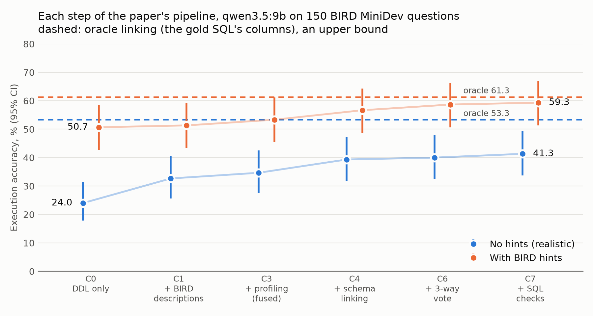
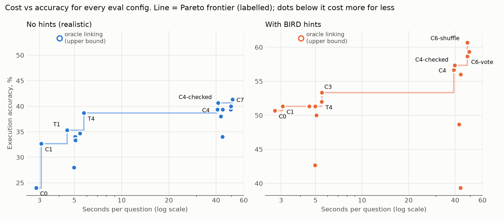

# Summary: 150 eval questions, qwen3.5:9b

Generated by `analysis/summary.py` from `results/per_question.csv`. Do not edit by hand.
EX = BIRD execution accuracy. CIs: Wilson for accuracies, paired bootstrap (10,000 resamples of questions) for differences. p: exact McNemar on the questions where the two configs disagree.

## The ladder (each step changes one thing)

| Step | What changes | EX no hints (95% CI) | Δ vs previous (95% CI), p | EX with hints (95% CI) | Δ vs previous (95% CI), p | Prompt tok/q | s/q | Paper, GPT-4o (no hints / hints) |
|---|---|---|---|---|---|---|---|---|
| **C0** | DDL only | 24.0 (18–31) | — | 50.7 (43–59) | — | 824 | 2.9 | 49.8 / — |
| **C1** | + BIRD column descriptions | 32.7 (26–41) | +8.7 (+2.7 to +15.3), p = 0.015 | 51.3 (43–59) | +0.7 (-5.3 to +6.7), p = 1.000 | 1,910 | 3.1 | 59.6 / 72.0 |
| **C3** | + LLM profiling summaries (fused) | 34.7 (28–43) | +2.0 (-6.0 to +10.0), p = 0.743 | 53.3 (45–61) | +2.0 (-6.0 to +9.3), p = 0.736 | 8,112 | 5.4 | 63.2 / 73.0 |
| **C4** | + schema linking | 39.3 (32–47) | +4.7 (-1.3 to +11.3), p = 0.210 | 56.7 (49–64) | +3.3 (-3.3 to +10.0), p = 0.442 | 18,387 | 40.8 | 63.2 / 73.0 |
| **C6** | + 3 candidates, majority vote | 40.0 (33–48) | +0.7 (-1.3 to +3.3), p = 1.000 | 58.7 (51–66) | +2.0 (-0.7 to +4.7), p = 0.375 | 20,252 | 49.7 | not isolated |
| **C7** | + SQL sanity checks | 41.3 (34–49) | +1.3 (+0.0 to +3.3), p = 0.500 | 59.3 (51–67) | +0.7 (+0.0 to +2.0), p = 1.000 | 20,523 | 50.9 | not isolated |
| **Oracle** | gold SQL's columns only (upper bound) | 53.3 (45–61) | +14.0 vs C4 (+8.0 to +20.7), p < 0.001 | 61.3 (53–69) | +4.7 vs C4 (-0.7 to +10.0), p = 0.143 | 748 | 4.0 | 69.0 / 77.4 |

*Paper numbers are GPT-4o with the paper's full pipeline (its Tables 1–2), for shape only. C4 maps to its Table 2 "our schema linking" row, the oracle to "perfect schema linking". The paper doesn't isolate voting or the SQL checks. Note the paper's own full-schema fused number differs between Table 1 (63.2 / 73.0) and Table 2 (61.2 / 71.2).*

## Pairwise tests over the ladder, Holm-adjusted

Cell = Δ EX in pp (column minus row), with the Holm-adjusted McNemar p over all 7 × 6 / 2 = 21 pairs in that table. **Bold** = significant after adjustment.

### No hints

| from ↓ / to → | C1 | C3 | C4 | C6 | C7 | Oracle |
|---|---|---|---|---|---|---|
| **C0** | +8.7 (0.176) | +10.7 (0.182) | **+15.3 (0.003)** | **+16.0 (0.003)** | **+17.3 (0.001)** | **+29.3 (<0.001)** |
| **C1** |  | +2.0 (1.000) | +6.7 (0.771) | +7.3 (0.637) | +8.7 (0.351) | **+20.7 (<0.001)** |
| **C3** |  |  | +4.7 (1.000) | +5.3 (0.910) | +6.7 (0.637) | **+18.7 (<0.001)** |
| **C4** |  |  |  | +0.7 (1.000) | +2.0 (1.000) | **+14.0 (<0.001)** |
| **C6** |  |  |  |  | +1.3 (1.000) | **+13.3 (0.001)** |
| **C7** |  |  |  |  |  | **+12.0 (0.012)** |

### With hints

| from ↓ / to → | C1 | C3 | C4 | C6 | C7 | Oracle |
|---|---|---|---|---|---|---|
| **C0** | +0.7 (1.000) | +2.7 (1.000) | +6.0 (1.000) | +8.0 (1.000) | +8.7 (1.000) | +10.7 (0.291) |
| **C1** |  | +2.0 (1.000) | +5.3 (1.000) | +7.3 (1.000) | +8.0 (1.000) | +10.0 (0.631) |
| **C3** |  |  | +3.3 (1.000) | +5.3 (1.000) | +6.0 (1.000) | +8.0 (0.952) |
| **C4** |  |  |  | +2.0 (1.000) | +2.7 (1.000) | +4.7 (1.000) |
| **C6** |  |  |  |  | +0.7 (1.000) | +2.7 (1.000) |
| **C7** |  |  |  |  |  | +2.0 (1.000) |

## Prompt trimming on C3 (T1–T4, D21)

Each trim removes one prompt section from C3 (fused metadata, full schema, one call). Holm adjustment over the 8 tests in this table. Verdicts were fixed before the eval run: **safe to trim** = the 95% CI lower bound of Δ is above -5 pp with and without hints; **hurts** = Holm p < 0.05 with Δ < 0; otherwise **inconclusive**. Token and time columns are the no-hints config.

| Trim | What is removed | Δ EX no hints (95% CI) | fixed / broke, Holm p | Δ EX with hints (95% CI) | fixed / broke, Holm p | Prompt tok/q (vs C3) | s/q | Verdict |
|---|---|---|---|---|---|---|---|---|
| **C3** | base: fused metadata, full schema | 34.7 | — | 53.3 | — | 8,112 | 5.4 | — |
| **T1** | long → short profile summaries | +0.7 (-6.0 to +7.3) | 14 / 13, p = 1.000 | -2.0 (-8.0 to +4.7) | 10 / 13, p = 1.000 | 4,546 (-44%) | 4.5 | inconclusive |
| **T2** | example values in profile summaries masked | -6.7 (-13.3 to +0.0) | 7 / 17, p = 0.447 | -10.7 (-16.7 to -4.7) | 4 / 20, p = 0.012 | 7,258 (-11%) | 5.0 | hurts |
| **T3** | BIRD value descriptions dropped | -1.3 (-6.7 to +4.0) | 7 / 9, p = 1.000 | -3.3 (-8.0 to +1.3) | 4 / 9, p = 1.000 | 7,483 (-8%) | 5.1 | inconclusive |
| **T4** | system prompt cut to one line | +4.0 (-1.3 to +9.3) | 11 / 5, p = 1.000 | -1.3 (-6.0 to +3.3) | 6 / 8, p = 1.000 | 8,061 (-1%) | 5.7 | inconclusive |

## Every eval config

| Config | Experiment | EX no hints (95% CI) | EX with hints (95% CI) | Valid SQL % (no hints) | LLM calls/q | Prompt tok/q | s/q |
|---|---|---|---|---|---|---|---|
| C3-fused | 01_metadata | 34.7 (28–43) | 53.3 (45–61) | 88.7 | 1.0 | 8,112 | 5.4 |
| C2-profile | 01_metadata | 34.0 (27–42) | 51.3 (43–59) | 84.7 | 1.0 | 7,027 | 5.1 |
| C0-ddl | 01_metadata | 24.0 (18–31) | 50.7 (43–59) | 90.0 | 1.0 | 824 | 2.9 |
| C1-bird | 01_metadata | 32.7 (26–41) | 51.3 (43–59) | 94.0 | 1.0 | 1,910 | 3.1 |
| C4-oracle | 02_linking | 53.3 (45–61) | 61.3 (53–69) | 94.7 | 1.0 | 748 | 4.0 |
| C4-linked | 02_linking | 39.3 (32–47) | 56.7 (49–64) | 94.7 | 6.3 | 18,387 | 40.8 |
| C5-train-sep | 03_fewshot | 38.0 (31–46) | 48.7 (41–57) | 86.0 | 6.3 | 19,037 | 42.9 |
| C5-querylog | 03_fewshot | 34.0 (27–42) | 39.3 (32–47) | 88.7 | 6.3 | 19,314 | 43.9 |
| C5-querylog-sep | 03_fewshot | 39.3 (32–47) | 56.0 (48–64) | 88.0 | 6.3 | 19,356 | 44.1 |
| C6-shuffle | 04_voting | 39.3 (32–47) | 60.7 (53–68) | 97.3 | 8.3 | 20,252 | 49.6 |
| C6-vote | 04_voting | 40.0 (33–48) | 58.7 (51–66) | 99.3 | 8.3 | 20,252 | 49.7 |
| C4-checked | 05_checks | 40.7 (33–49) | 57.3 (49–65) | 94.7 | 6.4 | 18,477 | 41.2 |
| C7 | 05_checks | 41.3 (34–49) | 59.3 (51–67) | 99.3 | 8.6 | 20,523 | 50.9 |
| T3-no-bird-values | 06_trimming | 33.3 (26–41) | 50.0 (42–58) | 87.3 | 1.0 | 7,483 | 5.1 |
| T1-short-profile | 06_trimming | 35.3 (28–43) | 51.3 (43–59) | 92.7 | 1.0 | 4,546 | 4.5 |
| T2-masked-values | 06_trimming | 28.0 (21–36) | 42.7 (35–51) | 91.3 | 1.0 | 7,258 | 5.0 |
| T4-minimal-system | 06_trimming | 38.7 (31–47) | 52.0 (44–60) | 90.0 | 1.0 | 8,061 | 5.7 |

